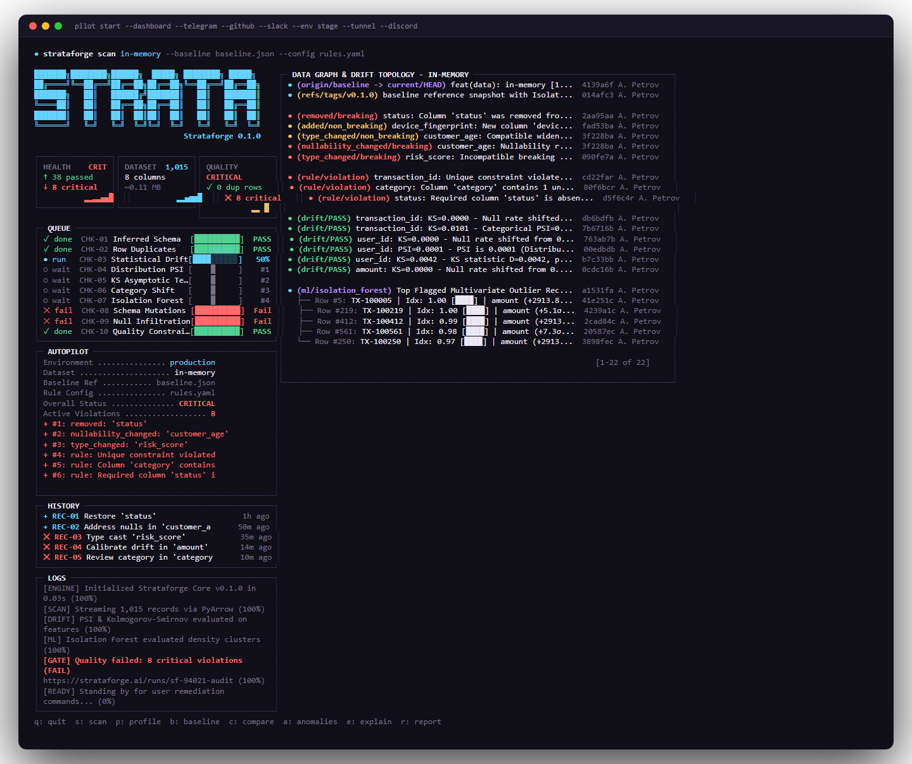
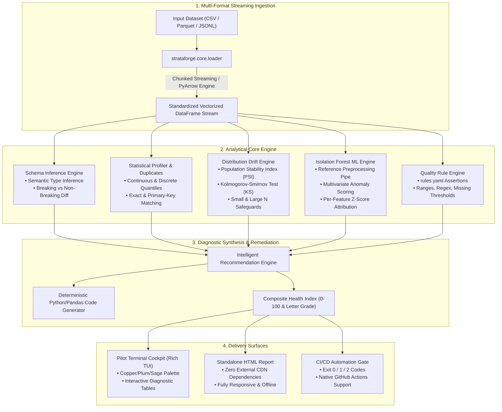
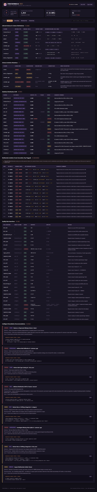

<p align="center">
  
</p>

# STRATAFORGE AI

<p align="center">
  <strong>Terminal-Native Intelligent Data-Quality Engine & Statistical Sentinel</strong><br />
  <em>Deterministic contracts, empirical distribution drift, multivariate Isolation Forests, and autonomous remediation for mission-critical data pipelines.</em>
</p>

<p align="center">
  <a href="https://www.python.org/downloads/"></a>
  <a href="https://github.com/astral-sh/ruff"></a>
  <a href="tests/"></a>
  <a href="https://hypothesis.readthedocs.io/"></a>
  <a href="https://playwright.dev/"></a>
  <a href="LICENSE"></a>
</p>

---

## Executive Overview

**Strataforge AI** is a high-throughput, terminal-native CLI engineered for software engineers, data engineers, and machine learning teams. It inspects datasets (`CSV`, `JSONL`, `Parquet`) directly in terminal and CI environments to uncover breaking schema mutations, silent statistical drift, missing-value spikes, and multivariate anomalies **before** they compromise downstream models, applications, or financial reports.

Operating strictly offline with zero external dependencies—**no web servers, no client databases, no cloud daemons, and zero telemetry tracking**—Strataforge pairs deterministic assertion gates with rigorous statistical hypothesis tests (Population Stability Index, Kolmogorov-Smirnov) and scikit-learn Isolation Forests to diagnose problems with absolute reproducibility.

---

## Key Capabilities

- **Semantic Schema Inference & Evolution**: Infers semantic types (`integer`, `float`, `boolean`, `datetime`, `categorical`, `string`) and separates breaking mutations (dropped columns, narrowing type changes, nullability regressions) from non-breaking widening.
- **Statistical Distribution Drift**: Computes Population Stability Index ($\text{PSI}$) and two-sample Kolmogorov-Smirnov ($D, p\text{-value}$) with sample-size safeguards against trivial false-positives at scale ($N > 10,000$) and low-power traps ($N < 30$).
- **Multivariate ML Anomaly Detection**: Trains an uncorrupted reference Isolation Forest on baseline features using median imputation and `RobustScaler`. Flags unusual multivariate record combinations and computes z-score feature deviation attributions for root-cause diagnosis.
- **Actionable Remediation Engine**: Synthesizes verified Python/pandas code snippets to resolve detected corruptions. Use `--fix-preview` to simulate data transformations without touching input files.
- **Pilot Developer Cockpit TUI**: Renders an Awwwards-caliber terminal interface with custom plum/copper/sage/coral color geometry, live KPI tiles, diagnostic tables, and severity badges.
- **Standalone Zero-Server HTML Report**: Exports self-contained, responsive HTML audits featuring SVG radial health gauges, client-side filtering, and payload drilldowns without external CDN requests.
- **Strict CI/CD Enforcement**: Clean deterministic exit codes (`0`: Pass, `1`: Quality Violation, `2`: System Error) with `--no-color` and `--compact` flags for GitHub Actions.

---

## Architectural Data Flow



---

## Terminal Cockpit Experience

Strataforge AI implements a purposeful terminal design language tailored for modern developers:

<p align="center">
  
</p>

### Palette & Visual Identity
- **Cockpit Base**: `#17151F` (Deep Plum/Slate)
- **Secondary Surfaces**: `#272039`
- **Accent Highlight**: `#E9AC74` (Warm Copper)
- **Success Safe**: `#91C8A8` (Sage Green)
- **Error Breach**: `#E77770` (Coral Red)
- **Warning Drift**: `#ECC06C` (Muted Gold)

---

## Standalone Interactive HTML Reports

Generate self-contained diagnostic artifacts for executive sharing, compliance audits, or pipeline artifacts:

```bash
strataforge report data/current.parquet --baseline baseline.json --config rules.yaml --out audit_report.html
```

<p align="center">
  
</p>

<p align="center">
  
</p>

- **Zero-Server Requirement**: Operates directly via `file://` protocol.
- **Embedded Visuals**: Built-in SVG radial health gauges with dynamic stroke animations.
- **Client-Side Filtering**: Live instant table search and severity tabs (`Critical`, `Warnings`, `Passed`).
- **Interactive Inspection**: Expand anomaly rows to inspect raw JSON record payloads and divergent z-scores.

---

## Installation & Quickstart

### Prerequisites
- Python 3.12 or newer.

```bash
# 1. Clone the repository
git clone https://github.com/aliahmed-io/Strataforge-AI.git
cd Strataforge-AI

# 2. Create virtual environment
python -m venv .venv
# On Linux/macOS:
source .venv/bin/activate
# On Windows:
.\.venv\Scripts\activate

# 3. Install in editable mode
pip install -e .
```

### 5-Minute Guided Tour

```bash
# Initialize demo workspace with sample baseline and corrupted datasets
strataforge init

# Run quick profile to inspect inferred schema and distributions
strataforge profile demo_baseline.csv

# Snapshot reference schema and train baseline Isolation Forest model
strataforge baseline demo_baseline.csv --out baseline.json

# Launch the pilot terminal cockpit audit against incoming data
strataforge cockpit demo_current.csv --baseline baseline.json --config rules.yaml

# Run statistical drift and schema comparison
strataforge compare demo_current.csv --baseline baseline.json

# Detect and explain multivariate outliers
strataforge anomalies demo_current.csv --baseline baseline.json --top 5

# Deep-dive into specific outlier row attribution
strataforge explain demo_current.csv --row 5 --baseline baseline.json

# Validate strict pipeline rules
strataforge validate demo_current.csv --config rules.yaml

# Generate static HTML report
strataforge report demo_current.csv --baseline baseline.json --config rules.yaml --out report.html
```

---

## CLI Command Reference

All commands support argument validation, clear error empathy, and structured exit codes:

| Command | Usage | Description |
| :--- | :--- | :--- |
| **`cockpit`** | `strataforge cockpit PATH [--baseline B] [--config C]` | Interactive terminal cockpit with live telemetry, KPI grid, and categorized findings. |
| **`scan`** | `strataforge scan PATH [--baseline B] [--config C]` | Standard quality audit: schema check, drift analysis, anomaly score, and rule assertions. |
| **`profile`** | `strataforge profile PATH [--chunk-size N]` | Displays inferred types, null counts, duplicate ratios, and distribution quantiles. |
| **`baseline`** | `strataforge baseline PATH --out baseline.json` | Creates serialized schema snapshot and fits baseline Isolation Forest preprocessor. |
| **`compare`** | `strataforge compare PATH --baseline baseline.json` | Identifies breaking schema mutations, continuous/discrete PSI drift, and KS statistics. |
| **`anomalies`** | `strataforge anomalies PATH [--baseline B] [--top N]` | Scores observations using multivariate Isolation Forest and ranks unusual records. |
| **`explain`** | `strataforge explain PATH --row ROW_ID [--baseline B]` | Explains flagged row via z-score deviations and feature contributions. |
| **`validate`** | `strataforge validate PATH --config rules.yaml` | Applies explicit schema rules, unique keys, regex checks, and range bounds. |
| **`report`** | `strataforge report PATH [--format html] [--out PATH]` | Compiles an offline, self-contained interactive HTML audit report. |
| **`init`** | `strataforge init [--out-dir PATH]` | Scaffolds `rules.yaml` and seeded demo datasets for rapid verification. |

### Global Flags
- `--no-color`: Disables ANSI formatting for clean plain-text log files (or set `NO_COLOR=1`).
- `--compact`: Renders compact ASCII tables optimized for terminal recording or simple logs.
- `--fix-preview`: Simulates proposed data cleaning steps without altering original files.

---

## Deterministic CI/CD Integration

Strataforge uses explicit exit codes designed to gate CI/CD pipelines:

| Exit Code | Classification | Meaning |
| :---: | :--- | :--- |
| **`0`** | **PASS** | Dataset is healthy; all schema checks, drift thresholds, and rules satisfied. |
| **`1`** | **QUALITY_VIOLATION** | Data quality failure detected (breaking schema mutation, critical PSI $\ge 0.25$, or rule breach). |
| **`2`** | **SYSTEM_ERROR** | Runtime error, missing file path, invalid YAML formatting, or IO exception. |

### GitHub Actions Workflow

Add `.github/workflows/data_quality.yml`:

```yaml
name: Data Quality Gate
on: [push, pull_request]

jobs:
  strataforge-audit:
    runs-on: ubuntu-latest
    steps:
      - uses: actions/checkout@v4
      - uses: actions/setup-python@v5
        with:
          python-version: '3.12'
      - name: Install Strataforge
        run: pip install .
      - name: Gate on Schema & Statistical Drift
        run: strataforge compare data/current.parquet --baseline baseline.json --no-color
      - name: Validate Contract Rules
        if: always()
        run: strataforge validate data/current.parquet --config rules.yaml --no-color
```

---

## Rigorous Testing & Benchmarks

The Strataforge test suite combines **59 automated tests** across 4 verification layers:

1. **Unit & Integration Suite**: Schema inference, drift algorithms, ML model persistence, and CLI commands.
2. **Property-Based Fuzzing (Hypothesis)**: Proves mathematical invariants for PSI ($\ge 0$), KS statistic bounds ($[0, 1]$), schema stability, and anomaly score boundaries ($[0, 1]$) under randomized edge-case arrays.
3. **Black-Box User Experience Tests**: Verifies error empathy, absence of unhandled tracebacks, and exit code precision.
4. **Visual & DOM Audits (Playwright)**: Launches headless Chromium to verify offline file loading, zero JavaScript errors, and mobile responsive layout.

### Microbenchmark SLAs (10,000 Rows)

```
Name (time in ms)                                Min      Mean     Median    OPS
---------------------------------------------------------------------------------
test_benchmark_profiling_10k_rows              19.4 ms  22.5 ms  22.7 ms   44.3
test_benchmark_drift_detection_10k_rows        26.8 ms  30.7 ms  30.2 ms   32.5
test_benchmark_isolation_forest_scoring       160.8 ms 166.3 ms 165.6 ms    6.0
```

Run test suite locally:
```bash
# Full test suite with benchmarks
pytest -v

# Strict lint sweep
ruff check .

# Code formatting verification
ruff format --check .
```

---

## License

Distributed under the **MIT License**. See [`LICENSE`](LICENSE) for complete details.
