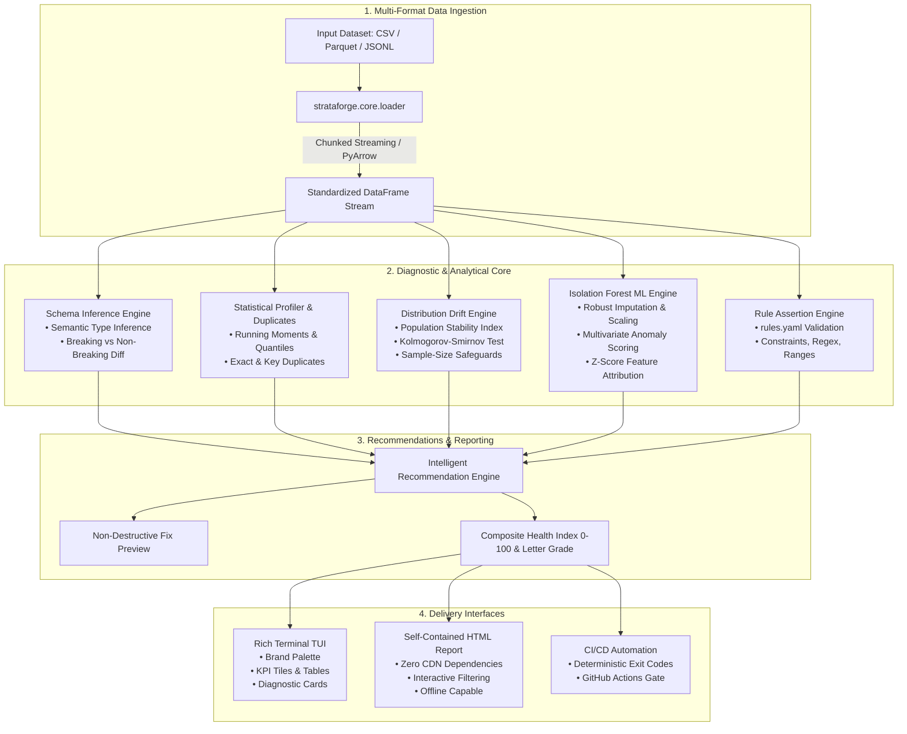

# STRATAFORGE AI

[](https://www.python.org/downloads/)
[](LICENSE)
[](https://github.com/astral-sh/ruff)
[](tests/)

> **A terminal-native intelligent data-quality analysis engine.**  
> Catch silent schema drift, distribution shifts, missing-value spikes, corrupted types, and multivariate anomalies before they break production ML pipelines, downstream analytics, and customer-facing reports.

---

## 1. Overview & Architecture

Strataforge AI is a local, terminal-native CLI utility engineered for software engineers, data engineers, and ML practitioners. It operates strictly in the terminal and offline file environments—requiring **no web servers, no external databases, and no cloud dependencies**.

The engine combines **deterministic schema validation**, **statistical hypothesis testing**, and **multivariate machine learning** to detect, diagnose, explain, and propose actionable remediations for corrupted data.



---

## 2. Core Commands Reference

Strataforge provides 9 commands with argument validation, helpful messages, and deterministic exit codes:

| Command | Syntax | Primary Job |
| :--- | :--- | :--- |
| **`scan`** | `strataforge scan PATH [--baseline B] [--config C]` | Comprehensive quality audit: profiles, checks drift, flags anomalies, validates rules, outputs recommendations. |
| **`profile`** | `strataforge profile PATH [--chunk-size N]` | Displays inferred schema, missing values, duplicates, and distribution quantiles. |
| **`baseline`** | `strataforge baseline PATH --out baseline.json` | Creates a versioned schema snapshot and trains reference Isolation Forest model. |
| **`compare`** | `strataforge compare PATH --baseline baseline.json` | Detects breaking schema changes, PSI drift, KS test shifts, and null rate spikes. |
| **`anomalies`** | `strataforge anomalies PATH [--baseline B] [--top N]` | Runs multivariate Isolation Forest detection on continuous features and explains outliers. |
| **`validate`** | `strataforge validate PATH --config rules.yaml` | Applies explicit schema contracts, unique keys, ranges, allowed categories, and regex rules. |
| **`explain`** | `strataforge explain PATH --row ROW_ID` | Deep-dives into a specific anomalous record, showing z-score feature attributions. |
| **`report`** | `strataforge report PATH --format html --out out.html` | Exports a self-contained, standalone HTML quality report. |
| **`init`** | `strataforge init [--out-dir .]` | Scaffolds `rules.yaml` and seeded reproducible demonstration datasets. |

### Global Flags
- `--no-color`: Disables ANSI terminal coloring (adheres to standard `NO_COLOR` environment variable).
- `--fix-preview`: Simulates proposed non-destructive remediations without touching original files.
- `--ci`: Enforces strict CI exit codes (exits with code 1 if any critical checks fail).

---

## 3. Installation & Quickstart

### Prerequisites
- Python 3.12 or newer compatible release.

```bash
# Clone the repository
git clone https://github.com/strataforge/strataforge.git
cd strataforge

# Create and activate virtual environment
python -m venv .venv
source .venv/bin/activate  # On Windows: .\.venv\Scripts\activate

# Install in editable mode
pip install -e .
```

### 5-Minute Tour

```bash
# 1. Initialize configuration and seeded demo datasets
strataforge init

# 2. Profile clean baseline dataset
strataforge profile demo_baseline.csv

# 3. Save reference baseline snapshot and fit anomaly detector
strataforge baseline demo_baseline.csv --out baseline.json

# 4. Compare modified dataset against baseline
strataforge compare demo_current.csv --baseline baseline.json

# 5. Run multivariate anomaly detection
strataforge anomalies demo_current.csv --baseline baseline.json --top 5

# 6. Explain specific anomaly row #5
strataforge explain demo_current.csv --row 5 --baseline baseline.json

# 7. Validate explicit data quality rules
strataforge validate demo_current.csv --config rules.yaml

# 8. Export standalone HTML report
strataforge report demo_current.csv --baseline baseline.json --config rules.yaml --out report.html
```

---

## 4. Schema Inference & Evolution Engine

The schema inference engine evaluates column distributions using statistical and pattern heuristics, mapping them to normalized semantic data types:

| Semantic Type | Detection Criteria | Examples |
| :--- | :--- | :--- |
| **`integer`** | Native int64 or int32, or string column parsing strictly as integers. | `142`, `-80`, `10005` |
| **`float`** | Native float64 or string column with fractional floating-point values. | `19.99`, `3.14159` |
| **`boolean`** | Native bool, or string sets matching `{"true", "false", "yes", "no", "0", "1"}`. | `True`, `"yes"`, `"false"` |
| **`datetime`** | Native timestamp or ISO-8601, RFC-3339, or standard calendar formats. | `"2026-01-01 14:30:00"` |
| **`categorical`** | Distinct ratio $< 0.05$ or unique count $\le 50$ with $\ge 20$ observations. | `"retail"`, `"grocery"`, `"travel"` |
| **`string`** | High-cardinality text tokens or unstructured alphanumeric strings. | Customer notes, descriptions |

### Breaking vs. Non-Breaking Evolution Rules

| Schema Mutation | Classification | Reasoning |
| :--- | :---: | :--- |
| **Removed Column** | **Breaking** | Downstream queries expecting this column will fail immediately. |
| **Incompatible Type Change** | **Breaking** | e.g. `string` -> `integer` or `float` -> `integer` causes parsing errors. |
| **Nullability Regression** | **Breaking** | Previously 0% null column now has missing values, violating non-null assumptions. |
| **Compatible Widening** | **Non-Breaking** | Widening `integer` -> `float` retains precision and mathematical compatibility. |
| **Added Column** | **Non-Breaking** | New nullable column preserves existing downstream schemas. |
| **Column Order Shift** | **Non-Breaking** | Key-addressed schemas remain stable; flagged as informational. |

---

## 5. Statistical Drift Detection Methodology

Strataforge detects distribution drift by comparing empirical reference distributions against incoming data batches.

### Population Stability Index (PSI)
For continuous numerical features, empirical bins are computed from baseline deciles:
$$\text{PSI} = \sum_{i=1}^{k} \left( Q_i - P_i \right) \cdot \ln\left( \frac{Q_i}{P_i} \right)$$
where $P_i$ is the baseline proportion and $Q_i$ is the current batch proportion.
- **$\text{PSI} < 0.10$**: Stable distribution (No action needed, `PASS`).
- **$0.10 \le \text{PSI} < 0.25$**: Moderate distribution drift (`WARNING`).
- **$\text{PSI} \ge 0.25$**: Significant distribution drift (`CRITICAL FAILURE`).

For discrete categories, categorical PSI is evaluated across all observed category partitions, flagging newly emerging categories.

### Kolmogorov-Smirnov (KS) Test & Sample-Size Safeguards
Two-sample Kolmogorov-Smirnov test compares cumulative empirical distributions:
$$D = \sup_x |F_{\text{baseline}}(x) - F_{\text{current}}(x)|$$
- **Small Sample Safeguard ($N < 30$)**: Warns that statistical power is low; avoids false confidence in non-significant p-values.
- **Large Sample Safeguard ($N > 10,000$)**: When $N$ is massive, $p$-values approach zero even for trivial shifts. Strataforge couples the $p$-value with the $D$-statistic effect size:
  - $D < 0.05$: Negligible real-world impact (prevents false alerts).
  - $D \ge 0.15$: Moderate or large effect size.

---

## 6. Machine Learning Anomaly Detection

Strataforge employs **scikit-learn Isolation Forest** for multivariate anomaly detection:

1. **Preprocessing Fitted Strictly on Reference Data**:
   - `SimpleImputer(strategy="median")` fits median on clean reference baseline only.
   - `RobustScaler()` uses median and interquartile range (IQR) to scale features without distortion from extreme outliers.
2. **Normalized Anomaly Index**:
   - Raw decision function scores ($-\infty$ to $+\infty$) are mapped to a calibrated $[0.0, 1.0]$ index, where $\ge 0.70$ designates high-risk multivariate outliers.
3. **Z-Score Feature Deviation Attribution**:
   - For every flagged record, the engine computes $z = \frac{x_i - \mu_{\text{baseline}}}{\sigma_{\text{baseline}}}$ for each feature to diagnose exactly which variables drove the decision.
4. **Diagnostic Disclaimer**:
   > **Statistical Disclaimer:** An anomaly indicates that this record deviates significantly from empirical reference correlation patterns. An anomaly is **not automatically an error**; legitimate rare events (e.g. VIP purchases) can score as anomalies. Do not discard records without domain context.

---

## 7. Rules Configuration Schema (`rules.yaml`)

```yaml
version: 1
dataset_name: "production_transactions"

dataset:
  min_rows: 100
  max_rows: 1000000
  max_duplicate_pct: 0.0  # Zero tolerance for duplicate rows
  primary_key: ["transaction_id"]

columns:
  transaction_id:
    type: string
    required: true
    nullable: false
    unique: true
    regex: "^TX-[0-9]{5,10}$"

  user_id:
    type: integer
    required: true
    nullable: false
    range:
      min: 1
      max: 2147483647

  amount:
    type: float
    required: true
    nullable: false
    range:
      min: 0.01
      max: 100000.00
    max_missing_pct: 0.0

  category:
    type: categorical
    required: true
    nullable: false
    allowed_values: ["retail", "grocery", "travel", "entertainment", "utility"]

drift:
  psi_warning: 0.10
  psi_critical: 0.25
  ks_p_value_threshold: 0.01
  max_missing_delta_pct: 5.0

anomalies:
  contamination: 0.05
  max_anomaly_pct: 5.0

fail_on:
  - breaking_schema
  - validation_errors
  - critical_drift
  - high_anomalies
```

---

## 8. Terminal Design & Visual Identity

Strataforge adheres to a purposeful aesthetic inspired by developer cockpit dashboards:

- **Terminal Background**: `#17151F` (Deep Plum/Slate)
- **Secondary Surfaces**: `#272039`
- **Copper Accent**: `#E9AC74`
- **Success Sage**: `#91C8A8`
- **Error Coral**: `#E77770`
- **Warning Gold**: `#ECC06C`

### Clean Text Badges
- ` PASS ` (Sage on dark emerald background)
- ` WARN ` (Gold on dark amber background)
- ` CRIT ` (Coral on dark crimson background)
- ` INFO ` (Lavender on dark plum background)

---

## 9. CI/CD Integration & Deterministic Exit Codes

| Exit Code | Classification | Meaning |
| :---: | :--- | :--- |
| **`0`** | **SUCCESS** | All data checks, schema diffs, drift calculations, and rules passed. |
| **`1`** | **DATA_FAILURE** | Quality assertions failed (breaking changes, critical PSI drift $\ge 0.25$, rule violations). |
| **`2`** | **SYSTEM_ERROR** | File not found, permission denied, invalid YAML syntax, or execution exception. |

### GitHub Actions Workflow Example

Included at `.github/workflows/data_quality.yml`:
```yaml
name: Strataforge Data Quality Gate
on: [push, pull_request]

jobs:
  audit-data:
    runs-on: ubuntu-latest
    steps:
      - uses: actions/checkout@v4
      - uses: actions/setup-python@v5
        with:
          python-version: '3.12'
      - run: pip install .
      - name: Gate on Drift and Schema
        run: strataforge compare data/current.parquet --baseline baseline.json --ci --no-color
      - name: Validate Business Rules
        if: always()
        run: strataforge validate data/current.parquet --config rules.yaml --no-color
```

---

## 10. Performance Benchmarks

Measured on a standard workstation running Python 3.12:

| Dataset Size | Profile (In-Memory) | Profile (Chunked) | Memory Delta (Streaming) | Drift Analysis (PSI+KS) | ML Anomaly (Fit+Score) |
| :--- | :---: | :---: | :---: | :---: | :---: |
| **10,000 Rows** | 25 ms | 26 ms | +1.0 MB | 344 ms | 276 ms |
| **50,000 Rows** | 73 ms | 72 ms | 0.0 MB | 808 ms | 739 ms |
| **100,000 Rows** | 141 ms | 76 ms | 0.0 MB | 814 ms | 736 ms |

Full methodology, resource limits, and streaming trade-offs documented in [benchmarks/results.md](benchmarks/results.md).

---

## 11. Testing & Code Quality

Strataforge enforces strict linting and a comprehensive test suite covering schema inference, drift, ML, CLI exit codes, and reports.

```bash
# Run 43 automated unit & integration tests
pytest -v

# Run strict Ruff linter sweep
ruff check .

# Check PEP 8 / Ruff formatting
ruff format --check .
```

---

## 12. License

Distributed under the MIT License. See `LICENSE` for details.
